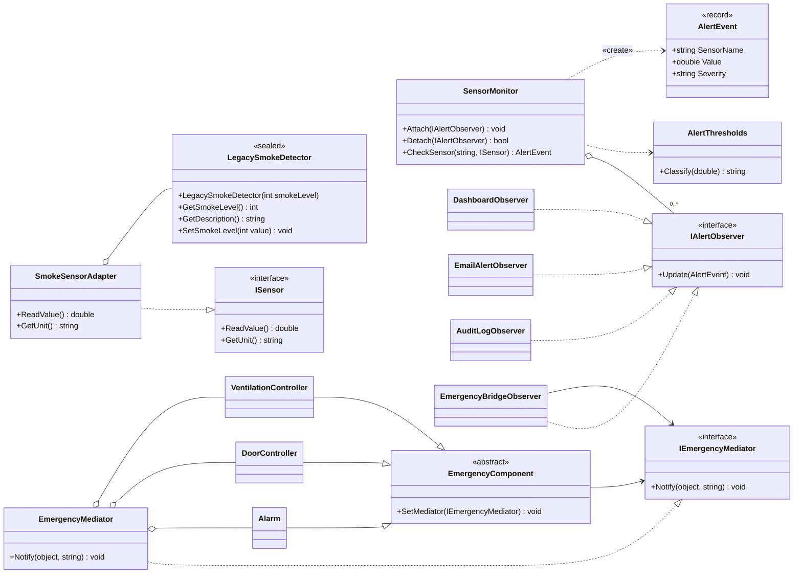
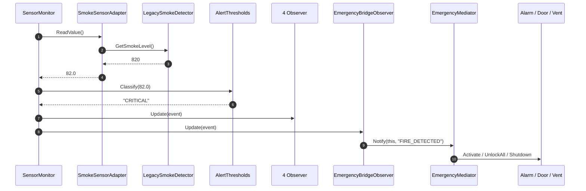

# Campus Safety Hub – Lab 11 (OOP)

Bài lab môn Lập trình hướng đối tượng. Em viết một chương trình Console mô phỏng
trung tâm giám sát an toàn cho một phòng máy, áp dụng ba mẫu thiết kế:

- Adapter: gắn cảm biến khói đời cũ vào giao diện cảm biến chuẩn mới.
- Observer: phát cảnh báo tới nhiều bên nhận, có thể đăng ký/hủy lúc chạy.
- Mediator: điều phối các thiết bị ứng phó (còi, cửa, thông gió) mà chúng không
  phụ thuộc trực tiếp vào nhau.

- Sinh viên: Phạm Quốc Huy
- Mã sinh viên: 202418915
- GitHub: https://github.com/huyp17-hub/OOP_B11

## 1. Cách chạy

Cần .NET SDK 8.0 trở lên (em làm trên .NET 10). Kiểm tra bằng `dotnet --version`.

```bash
# Chạy kịch bản demo
dotnet run --project src/CampusSafetyHub

# Chạy bộ test (in [PASS]/[FAIL], mã thoát bằng số test FAIL)
dotnet run --project src/CampusSafetyHub -- test
```

## 2. Cấu trúc thư mục

```
/
├─ CampusSafetyHub.sln
├─ README.md
├─ docs/
│  ├─ class-diagram.mmd        # sơ đồ lớp (Mermaid)
│  ├─ class-diagram.dot        # sơ đồ lớp chi tiết (Graphviz), xuất ra class-diagram.png
│  ├─ sequence-fire.mmd        # sơ đồ tuần tự luồng cháy (Mermaid)
│  ├─ demo-output.txt          # kết quả chạy demo
│  ├─ test-output.txt          # kết quả chạy test
│  └─ report/                  # báo cáo Word/PDF
└─ src/CampusSafetyHub/
   ├─ CampusSafetyHub.csproj
   ├─ Program.cs               # điểm vào: demo hoặc test
   ├─ Sensors/                 # ISensor, LegacySmokeDetector, SmokeSensorAdapter
   ├─ Alerts/                  # AlertEvent, AlertSeverity, AlertThresholds
   ├─ Monitoring/              # IAlertObserver, SensorMonitor
   ├─ Observers/               # Dashboard, Email, AuditLog, EmergencyBridge
   ├─ Emergency/               # IEmergencyMediator, EmergencyMediator, các thiết bị
   └─ Tests/                   # TestRunner (bộ test tự viết)
```

## 3. Sơ đồ

### 3.1. Sơ đồ lớp

Ảnh PNG chi tiết nằm ở `docs/class-diagram.png` (vẽ từ file `class-diagram.dot`). Dưới đây là mã
Mermaid, GitHub tự dựng hình khi xem online:



### 3.2. Sơ đồ tuần tự – luồng khói 82% (CRITICAL)

Ảnh PNG nằm ở `docs/sequence-fire.png`. Mã Mermaid:



## 4. Trách nhiệm của từng lớp

| Lớp / interface | Loại | Trách nhiệm |
|---|---|---|
| `ISensor` | interface | Giao diện cảm biến chuẩn mới: `ReadValue()`, `GetUnit()`. |
| `LegacySmokeDetector` | class (có sẵn) | Cảm biến khói đời cũ, thang 0..1000. Không được sửa. |
| `SmokeSensorAdapter` | class sealed | Adapter: bọc cảm biến cũ, quy giá trị về phần trăm. |
| `AlertEvent` | record | Dữ liệu một lần cảnh báo, bất biến. |
| `AlertSeverity` | static | Hằng số mức độ `WARNING`, `CRITICAL`. |
| `AlertThresholds` | class sealed | Nơi duy nhất phân loại ngưỡng (`Classify`). |
| `IAlertObserver` | interface | Bên nhận cảnh báo (`Update`). |
| `SensorMonitor` | class sealed | Subject của Observer: đọc cảm biến, phát cảnh báo, xử lý lỗi từng observer. |
| `DashboardObserver` | class sealed | In cảnh báo ra bảng điều khiển. |
| `EmailAlertObserver` | class sealed | Mô phỏng gửi email theo mức độ tối thiểu. |
| `AuditLogObserver` | class sealed | Ghi nhật ký kiểm toán, lộ `Entries` để kiểm thử. |
| `EmergencyBridgeObserver` | class sealed | Cầu nối: chỉ chuyển `CRITICAL` thành sự kiện cho mediator. |
| `IEmergencyMediator` | interface | Giao diện trung gian (`Notify`). |
| `EmergencyComponent` | abstract | Lớp cơ sở thiết bị, giữ tham chiếu tới mediator. |
| `EmergencyMediator` | class sealed | Concrete mediator: điều phối còi, cửa, thông gió. |
| `Alarm` | class sealed | Còi báo động; khi tắt thì báo mediator. |
| `DoorController` | class sealed | Mở/khóa cửa thoát hiểm. |
| `VentilationController` | class sealed | Tắt/bật thông gió. |
| `EmergencyEvents` | static | Hằng số mã sự kiện `FIRE_DETECTED`, `ALARM_RESET`. |

## 5. Ba mẫu thiết kế

### Adapter – `SmokeSensorAdapter`
- Nằm ở: `src/CampusSafetyHub/Sensors/SmokeSensorAdapter.cs`.
- Vấn đề: cảm biến cũ dùng thang 0..1000 và API riêng, không khớp `ISensor`.
- Cách làm: object adapter – adapter **chứa** một `LegacySmokeDetector` và cài đặt
  `ISensor`, mỗi lần đọc thì gọi lại cảm biến cũ rồi chia 10.
- Lợi ích: phần còn lại của hệ thống chỉ biết `ISensor`; đổi thiết bị cũ khác không
  ảnh hưởng. Hạn chế: thêm một lớp trung gian; nếu cần nhiều hàm của cảm biến cũ thì
  phải bọc thêm.

### Observer – `SensorMonitor` + các `IAlertObserver`
- Nằm ở: `Monitoring/SensorMonitor.cs` và thư mục `Observers/`.
- Vấn đề: một cảnh báo cần tới nhiều bên nhận, và danh sách bên nhận thay đổi lúc chạy.
- Cách làm: monitor giữ danh sách `IAlertObserver`, cho `Attach`/`Detach`, khi có cảnh
  báo thì duyệt bản sao danh sách và gọi `Update`. Mỗi observer được bọc `try/catch`
  riêng nên một observer lỗi không làm hỏng các observer khác.
- Lợi ích: thêm/bớt bên nhận không cần sửa monitor. Hạn chế: thứ tự thông báo phụ thuộc
  thứ tự đăng ký; nếu observer làm việc nặng sẽ làm chậm cả vòng.

### Mediator – `EmergencyMediator`
- Nằm ở: `Emergency/EmergencyMediator.cs`.
- Vấn đề: khi cháy cần phối hợp còi, cửa, thông gió; không muốn các thiết bị gọi thẳng nhau.
- Cách làm: các thiết bị chỉ biết `IEmergencyMediator`. Mediator nhận mã sự kiện và ra lệnh
  cho từng thiết bị; còi khi tắt chỉ báo `ALARM_RESET`, mediator mới khóa cửa và bật lại thông gió.
- Lợi ích: thiết bị không phụ thuộc nhau, dễ thêm thiết bị mới. Hạn chế: mediator dễ phình to
  khi logic phối hợp phức tạp.

## 6. Trả lời câu hỏi thiết kế (phần A)

1. **Adapter nên kế thừa hay chứa `LegacySmokeDetector`?** → **Chứa** (object adapter).
   Lý do: lớp cũ được khai báo `sealed` nên không kế thừa được; ngoài ra chứa thì giấu được
   API cũ, có thể thay bằng thiết bị cũ khác, và không bị ràng buộc vào lớp cũ qua kế thừa.
2. **`SensorMonitor` có nên biết `EmailAlertObserver` cụ thể không?** → **Không**. Monitor
   chỉ làm việc với `IAlertObserver`, nhờ vậy thêm/bớt loại observer không phải sửa monitor.
3. **`Alarm` có cần tham chiếu tới `DoorController` không?** → **Không**. Mọi phối hợp đi qua
   mediator; `Alarm` chỉ phát sự kiện `ALARM_RESET`. (Test T12 kiểm tra `Alarm` không có field
   kiểu `DoorController`.)
4. **Ai quyết định ngưỡng?** → `AlertThresholds` (qua `Classify`), được `SensorMonitor` dùng.
   Observer **không** tự quyết định ngưỡng.

## 7. Kết quả chạy

### Demo (rút gọn, bản đầy đủ ở `docs/demo-output.txt`)

```
1. Adapter: Cảm biến cũ mức 735 → 73.5% smoke
3. Khói 30% → Không phát cảnh báo (dưới ngưỡng).
4. Khói 55% → WARNING: Dashboard, Email, Audit nhận; bridge bỏ qua.
5. Khói 82% → CRITICAL: tất cả nhận; mediator bật còi, mở cửa, tắt thông gió.
6. Gỡ EmailAlertObserver, đọc lại 82% → không còn dòng EMAIL.
7. Attach lại dashboard → số observer vẫn là 3.
8. Reset còi → mediator khóa cửa, bật lại thông gió.
```

### Test

```
TỔNG KẾT: 14 PASS, 0 FAIL / 14 test.
```

Bản đầy đủ ở `docs/test-output.txt`. Để kiểm tra độ tin cậy của bộ test, em tạm đổi ngưỡng
CRITICAL từ 70 thành 75: test T4 báo FAIL đúng như mong đợi, sau đó em hoàn tác (không commit
bản sửa).
