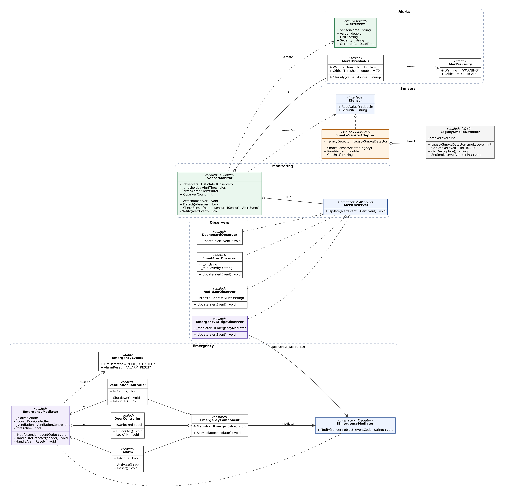
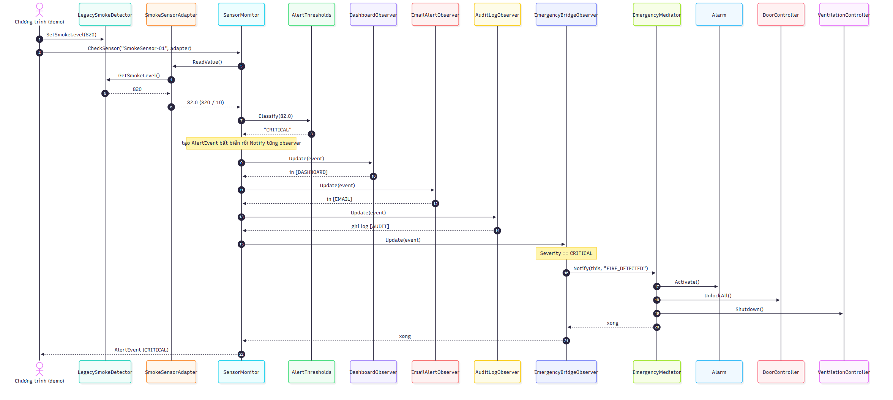

# Báo cáo Lab 11 – Campus Safety Hub

- **Họ tên:** Phạm Quốc Huy
- **Mã sinh viên:** 202418915
- **Môn:** Lập trình hướng đối tượng
- **GitHub:** [https://github.com/huyp17-hub/OOP_B11](https://github.com/huyp17-hub/OOP_B11)

Chương trình Console mô phỏng trung tâm giám sát an toàn cho một phòng máy, áp dụng
ba mẫu thiết kế: **Adapter** (gắn cảm biến khói đời cũ vào giao diện chuẩn mới),
**Observer** (phát cảnh báo tới nhiều bên nhận, đăng ký/hủy lúc chạy) và **Mediator**
(điều phối các thiết bị ứng phó mà chúng không phụ thuộc trực tiếp vào nhau).

## 1. Danh sách lớp

| Lớp / interface | Loại | Vai trò | Mẫu thiết kế |
|---|---|---|---|
| `ISensor` | interface | Giao diện cảm biến chuẩn mới | Adapter (target) |
| `LegacySmokeDetector` | class (có sẵn) | Cảm biến khói cũ, thang 0..1000 | Adapter (adaptee) |
| `SmokeSensorAdapter` | class sealed | Quy giá trị cũ về phần trăm | Adapter (adapter) |
| `AlertEvent` | record | Dữ liệu cảnh báo bất biến | Observer |
| `AlertSeverity` | static class | Hằng số mức độ cảnh báo | — |
| `AlertThresholds` | class sealed | Phân loại ngưỡng (nguồn duy nhất) | — |
| `IAlertObserver` | interface | Bên nhận cảnh báo | Observer (observer) |
| `SensorMonitor` | class sealed | Đọc cảm biến, phát cảnh báo | Observer (subject) |
| `DashboardObserver` | class sealed | In cảnh báo ra bảng điều khiển | Observer |
| `EmailAlertObserver` | class sealed | Mô phỏng gửi email | Observer |
| `AuditLogObserver` | class sealed | Ghi nhật ký kiểm toán | Observer |
| `EmergencyBridgeObserver` | class sealed | Cầu nối Observer → Mediator | Observer + Mediator |
| `IEmergencyMediator` | interface | Giao diện trung gian | Mediator (mediator) |
| `EmergencyComponent` | abstract class | Lớp cơ sở thiết bị | Mediator (colleague) |
| `EmergencyMediator` | class sealed | Điều phối còi, cửa, thông gió | Mediator |
| `Alarm` | class sealed | Còi báo động | Mediator (colleague) |
| `DoorController` | class sealed | Cửa thoát hiểm | Mediator (colleague) |
| `VentilationController` | class sealed | Hệ thống thông gió | Mediator (colleague) |
| `EmergencyEvents` | static class | Hằng số mã sự kiện | — |

## 2. Sơ đồ quan hệ

Sơ đồ lớp đầy đủ ở `docs/class-diagram.mmd` (ảnh `docs/class-diagram.png`), sơ đồ
tuần tự ở `docs/sequence-fire.mmd` (ảnh `docs/sequence-fire.png`).

### Giải thích các quan hệ

| Quan hệ | Loại | Ý nghĩa |
|---|---|---|
| `SmokeSensorAdapter` ..|> `ISensor` | realization | Adapter cài đặt giao diện chuẩn |
| `SmokeSensorAdapter` o-- `LegacySmokeDetector` | composition | Adapter chứa cảm biến cũ (object adapter) |
| Các observer ..|> `IAlertObserver` | realization | Mọi observer cài đặt chung một giao diện |
| `SensorMonitor` o-- `IAlertObserver` | association | Monitor giữ danh sách observer |
| `SensorMonitor` ..> `AlertThresholds` | dependency «use» | Dùng để phân loại ngưỡng |
| `SensorMonitor` ..> `AlertEvent` | dependency «create» | Tạo cảnh báo khi vượt ngưỡng |
| `EmergencyBridgeObserver` --> `IEmergencyMediator` | association | Gọi `Notify` qua interface |
| `EmergencyMediator` ..|> `IEmergencyMediator` | realization | Concrete mediator |
| `Alarm`/`DoorController`/`VentilationController` --|> `EmergencyComponent` | inheritance | Các thiết bị kế thừa lớp cơ sở |
| `EmergencyComponent` --> `IEmergencyMediator` | association | Thiết bị chỉ biết mediator, không biết nhau |
| `EmergencyMediator` o-- các thiết bị | composition | Mediator điều phối ba thiết bị |

## 3. Kết quả chạy (demo)

Các bước chính của kịch bản demo (bản đầy đủ ở `docs/demo-output.txt`):

1. **Adapter:** cảm biến cũ mức 735 đọc qua `ISensor` ra `73.5% smoke`.
2. **Dựng hệ thống:** monitor gắn 4 observer; mediator giữ 3 thiết bị; cầu nối nối observer với mediator.
3. **Khói 30%:** dưới ngưỡng → không phát cảnh báo.
4. **Khói 55%:** `WARNING` → Dashboard, Email, Audit nhận; cầu nối bỏ qua (chưa phải CRITICAL).
5. **Khói 82%:** `CRITICAL` → tất cả nhận; mediator bật còi, mở cửa, tắt thông gió.
6. **Gỡ Email rồi đọc lại 82%:** không còn dòng `[EMAIL]`; mediator đang trong trạng thái cháy nên chỉ ghi "đã xử lý".
7. **Attach lại dashboard:** số observer không tăng (chống đăng ký trùng).
8. **Reset còi:** mediator khóa cửa, bật lại thông gió.
9. **In toàn bộ nhật ký Audit.**

## 4. Kiểm thử

Bộ test tự viết trong `src/CampusSafetyHub/Tests/TestRunner.cs`, chạy bằng
`dotnet run --project src/CampusSafetyHub -- test`. Kết quả: **14 PASS, 0 FAIL**
(bản đầy đủ ở `docs/test-output.txt`).

| Mã | Tình huống | Mong đợi | Thực tế | KQ |
|---|---|---|---|---|
| T1 | Adapter mức 735 | 73.5, `% smoke` | 73.5, `% smoke` | PASS |
| T2 | Đổi lớp cũ sang 400 | ReadValue = 40.0 | 40.0 | PASS |
| T3 | Biên 0/1000, null ctor | 0, 100, ném `ArgumentNullException` | đúng | PASS |
| T4 | Ngưỡng 49.9/50/69.9/70 | none/WARNING/WARNING/CRITICAL | đúng | PASS |
| T5 | Attach trùng | ObserverCount = 1, nhận 1 lần | đúng | PASS |
| T6 | Detach | không nhận; Detach lạ không lỗi | đúng | PASS |
| T7 | Observer tự Detach khi nhận | vòng lặp không lỗi, observer khác nhận đủ | đúng | PASS |
| T8 | Observer ném lỗi | observer khác vẫn nhận, có log lỗi | đúng | PASS |
| T9 | AlertEvent bất biến | không setter public, hai observer cùng đối tượng | đúng | PASS |
| T10 | Bridge WARNING/CRITICAL | không gọi / gọi `FIRE_DETECTED` | đúng | PASS |
| T11 | Mediator FIRE_DETECTED | còi bật, cửa mở, thông gió tắt | đúng | PASS |
| T12 | Alarm.Reset + reflection | cửa khóa, thông gió chạy; Alarm không có field `DoorController` | đúng | PASS |
| T13 | Sự kiện lạ / cháy lặp | không đổi trạng thái; không bật còi lần nữa | đúng | PASS |
| T14 | Tích hợp khói 820 | 4 observer nhận, mediator xử lý đúng | đúng | PASS |

**Kiểm tra độ tin cậy của bộ test:** em tạm đổi ngưỡng `CRITICAL` từ 70 thành 75.
Khi đó `Classify(70)` trả về `WARNING` thay vì `CRITICAL`, nên **T4 báo FAIL**
(13 PASS, 1 FAIL) đúng như mong đợi. Sau đó em hoàn tác thay đổi, không commit bản sửa.
Điều này cho thấy test thực sự kiểm tra hành vi chứ không luôn luôn PASS.

## 5. Trả lời câu hỏi thiết kế

1. **Adapter nên kế thừa hay chứa `LegacySmokeDetector`?** → **Chứa** (object adapter).
   Giấu được API cũ, có thể thay thiết bị cũ khác, không bị ràng buộc qua kế thừa.
2. **`SensorMonitor` có nên biết `EmailAlertObserver` cụ thể không?** → **Không**, chỉ biết
   `IAlertObserver`; thêm/bớt loại observer không phải sửa monitor.
3. **`Alarm` có cần tham chiếu `DoorController` không?** → **Không**, mọi phối hợp đi qua
   mediator; `Alarm` chỉ phát `ALARM_RESET` (test T12 xác nhận bằng reflection).
4. **Ai quyết định ngưỡng?** → `AlertThresholds` qua `Classify`, được `SensorMonitor` dùng;
   observer không tự quyết định.
